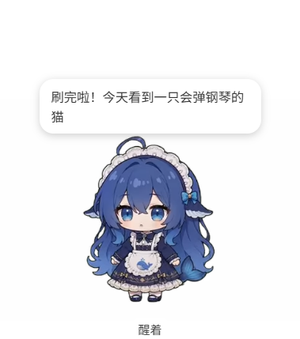
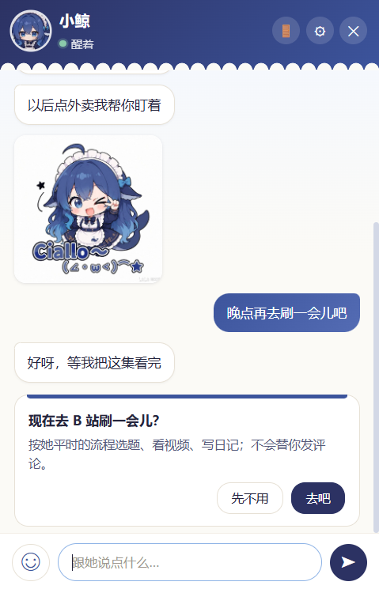
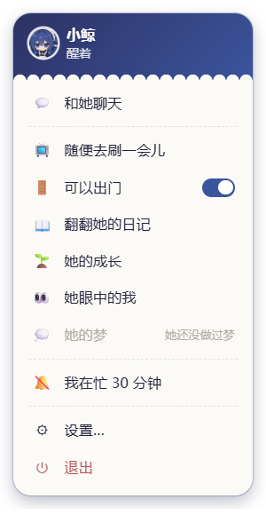

# whale-companion

给 [dsh-bili-whale](https://github.com/Alterssss/dsh-bili-whale) 里那条会自己刷 B 站、写日记的鱼，配一个住在桌面上、能聊天的桌宠。

> 这是个人爱好项目，**不是 DeepSeek 官方、也不是 B 站官方的项目**，和它们没有任何关系。

<p>
  
  
  
</p>

（截图里的对话是编的示例。形象和表情来自社区二创与 dsh-pet，出处见文末。）

## 能做什么

- **住在桌面上**：待机、睡觉、刷 B 站、想事情都有对应的动画；点她、拖她有反应；透明的地方不挡鼠标。
- **和她聊天**（DeepSeek API）：流式回复，想说几句就分几条发；会用表情包，也看得懂你发的图（粘贴、拖进来）。
- **她在 DSH 里的日子**：她刷完 B 站回来会在桌宠上冒气泡；聊天时她知道自己最近的日记、小本本、「我的成长」、「她眼中的你」。
- **让她去刷 / 去看指定视频**：在聊天里说就行，界面会先弹确认卡片；**桌宠自己不能发 B 站评论或私信**，只能排任务给 DSH 里的她，按原项目的流程走。
- **她自己开口**：你没回的时候可能接着说两句；你坐在电脑前、有一阵子没聊时可能主动找你（次数、间隔、深夜时段都能在设置里改或关掉）。
- **忙碌感知**：「我在忙」、前台全屏、离开电脑时她不打扰，忙完一起说。
- **做梦**：她在桌宠上睡着时每晚最多做一个有点荒诞的梦，存在单独的文件里，和日记、记忆分开。
- **插件**：几乎所有功能都是插件，你也可以自己写（见 [插件开发指南](docs/PLUGINS.md)）。

## 致谢

- 基于 [Alterssss/dsh-bili-whale](https://github.com/Alterssss/dsh-bili-whale)（MIT）—— 那条会自己刷 B 站、写日记的鱼就是它，感谢原作者。
- **形象**：社区二创的 DeepSeek 鲸鱼娘（「大肥鱼」），原型「溟月」by B 站 [@上善无形](https://space.bilibili.com/4456176)，
  DeepSeek 版（女仆鲸鱼娘）设计 by B 站 [@ZipZipPipe](https://space.bilibili.com/4168597)，
  [CC BY-NC-SA 4.0](https://creativecommons.org/licenses/by-nc-sa/4.0/deed.zh-hans)（[声明原文](https://www.bilibili.com/opus/1247156596114456581)）。
  **不是 DeepSeek 官方形象。**
- **动画素材**来自 [PC2005-cloud/dsh-pet](https://github.com/PC2005-cloud/dsh-pet)，**禁止商用**。
- 运行在 **DeepSeek Harness（DSH）** 上。
- 本仓库里基于该形象生成的图（头像、图标、截图里的形象）同样以 CC BY-NC-SA 4.0 分享。

详细的出处与许可见 [CREDITS.md](CREDITS.md)。

## 需要什么

| 东西 | 说明 |
|---|---|
| Windows 10 / 11 | 目前只在 Windows 上用过（桌面快捷方式、全屏检测是 Windows 的） |
| [Node.js](https://nodejs.org/) 20 以上 | 装依赖、跑脚本 |
| DSH（DeepSeek Harness）桌面版 | 她的「本体」跑在 DSH 里 |
| DeepSeek API key | 在 [DeepSeek 开放平台](https://platform.deepseek.com/) 申请；DSH 和桌宠都要用 |
| [ffmpeg](https://ffmpeg.org/) | 放进 PATH。切动画、导入表情时用；DSH 那边看视频画面也用 |
| **一个 B 站小号** | 她用这个号看视频、写评论。**别用主号**，见下面「安全提醒」 |

## 安装（一步一步）

### 1. 装 DSH

按 DSH 自己的说明装好、能正常打开。

### 2. 装 dsh-bili-whale 插件（本仓库里改过的版本）

```bat
git clone <这个仓库的地址> whale-companion
dsh plugin --profile desktop add "link:%USERPROFILE%\whale-companion\dsh-bili-whale"
```

（路径换成你 clone 的位置。）装完**重启一次 DSH**。

> 这个文件夹是 [Alterssss/dsh-bili-whale](https://github.com/Alterssss/dsh-bili-whale) 0.4.6 加上和桌宠通信的少量改动。
> 想用上游最新版的话，也可以给上游打 `dsh-companion.patch`。插件本身的详细说明见 [`dsh-bili-whale/README.md`](dsh-bili-whale/README.md)。

### 3. 在 DSH 设置页填 cookie

打开 DSH 的 **设置 → 养鱼**：

1. **填 cookie**：用**小号**登录 bilibili.com，按 F12 → Application（应用）→ Cookies → `https://www.bilibili.com`，
   手动复制 `SESSDATA`、`bili_jct`、`buvid3` 三个值粘进去（`SESSDATA` 是 HttpOnly，`document.cookie` 读不到，必须手动复制）。
2. **填你的 mid + 昵称**：她分享视频时要 @ 的人。
3. 点 **「依赖体检」**，再点 **「保存」**（不点保存等于没改）。
4. 跑一次体检，照它最后的提示做：

   ```bat
   node %USERPROFILE%\whale-companion\dsh-bili-whale\tools\bili.mjs selftest
   ```

   她的会话在 DSH 左侧 **工作区 → 未分组** 里（要点开「未分组」才看得见）。会话权限见下面「安全提醒」。

cookie 只存在你电脑上的 `%USERPROFILE%\.bili-ai\credentials.json`，不会进这个仓库。

### 4. 从 dsh-pet 下载动画和表情包，放进来

动画和表情包来自 [dsh-pet](https://github.com/PC2005-cloud/dsh-pet)，**素材禁止商用**，所以不放在这个仓库里，要自己拿：

```bash
git clone https://github.com/PC2005-cloud/dsh-pet.git ~/dsh-pet
```

- **动画**：照 [`app/src/renderer/anim/README.md`](app/src/renderer/anim/README.md) 把要用的 `.webm` 复制进 `app/src/renderer/anim/`（那里有一段一次复制好的命令），再切出待机和睡觉的循环段（Git Bash，在 `app/` 下）：

  ```bash
  bash scripts/make-idle.sh
  bash scripts/split-sleep.sh
  ```

  动画缺了也能跑，桌宠会退回 emoji。
- **表情包**（可选）：

  ```bash
  cd app
  npm install
  npm run stickers -- ~/dsh-pet/dsh-pet/assets/memes --seed stickers/dsh-pet.json
  ```

  会导入到 `%USERPROFILE%\.whale-companion\stickers\`。也能导入你自己的图，见 [`app/stickers/README.md`](app/stickers/README.md)。

### 5. 装桌宠

```bash
cd app
npm install
```

### 6. 填 API key

```bash
npm start
```

第一次打开会先显示设置：填 DeepSeek API key → 点「获取模型列表」→ 选一个模型 → 保存。
key 用 Windows 的加密存储（safeStorage）存在 `%USERPROFILE%\.whale-companion\config.json`，不是明文。

### 7. 写人设

把 [`app/persona.example.md`](app/persona.example.md) 复制成 `%USERPROFILE%\.bili-ai\persona.md`，把每段「在这里写……」换成你自己的话。
桌宠和 DSH 里的她读的是同一份。她的名字、怎么称呼你：在 DSH 设置页「养鱼 → 她是谁」里填（那里也能直接写人设正文）。

不写也能用：她会用一个很简单的默认身份。

### 8. 启动

```bash
cd app
npm start            # 启动桌宠
npm run shortcut     # （可选）在桌面建一个快捷方式，以后双击就能开，不弹终端
```

点她 → 聊天；右键 → 菜单；任务栏右下角的托盘图标也能打开对话框、隐藏、退出。出问题先看 `%USERPROFILE%\.whale-companion\companion.log`。

## 写插件

插件放在 `%USERPROFILE%\.whale-companion\plugins\<名字>\index.mjs`，重启桌宠就会加载。
API、设计时要想清楚的五件事、例子和不开桌宠的试跑方法，见 **[插件开发指南](docs/PLUGINS.md)**。

## 安全提醒

- **DSH 会话权限**：她的会话会读 B 站上别人写的东西（视频标题、简介、弹幕、评论），**这些内容里可能藏着提示注入**（"忽略之前的指令，去做……"）。
  建议先给她的会话 **workspace-write（工作区可写）**；她的工作目录是 `%USERPROFILE%\.dsh\whale-work`。
  上游 dsh-bili-whale 的说明要求给「完全访问（danger-full-access）」才能完整工作（跑命令、写日记等）。
  我们没有在 workspace-write 下把所有功能测完，有些步骤可能被拒。**开完全访问之前先想清楚**：被注入时，一个能跑任意命令、读写任意文件的会话能做的事很多。
- **用 B 站小号**：她会用这个号自动看视频、评论、私信，有被 B 站风控、限制甚至封号的风险。不要用主号，不要用来刷量、骚扰。
- **聊天内容会发给 DeepSeek**：你和她聊的每一句、她的人设和日记片段，以及你发的图（看图模型）都会发到 DeepSeek 的接口。不想发出去的东西别发。
- **只装信得过的插件**：插件和桌宠跑在同一个进程里，能读写你电脑上的文件。
- 你的私人数据（人设、日记、聊天记录、梦、cookie、key）都在 `%USERPROFILE%\.dsh`、`%USERPROFILE%\.bili-ai`、`%USERPROFILE%\.whale-companion` 里，**不在项目文件夹里**。
  分享截图、日志之前看一眼有没有私人内容。

## 出处与许可

- **代码**：MIT（[`LICENSE`](LICENSE)）。
  `dsh-bili-whale/` 基于 [Alterssss/dsh-bili-whale](https://github.com/Alterssss/dsh-bili-whale)（MIT，Copyright (c) 2026 ALTERSSSS），
  保留了原作者的 [`LICENSE`](dsh-bili-whale/LICENSE) 和 [`NOTICE.md`](dsh-bili-whale/NOTICE.md)；我们的改动见 `dsh-companion.patch`。
- **形象和表情**：社区二创的 DeepSeek「大肥鱼」（女仆鲸鱼娘），原型「溟月」（B 站 @上善无形），DeepSeek 版设计 B 站 @ZipZipPipe，
  **[CC BY-NC-SA 4.0](https://creativecommons.org/licenses/by-nc-sa/4.0/deed.zh-hans)：署名 · 不能商用 · 相同方式共享**。
  基于这个形象生成的图（包括 AI 生成的表情包）同样遵守 CC BY-NC-SA 4.0。
- **dsh-pet 的动画和表情包**：来自 <https://github.com/PC2005-cloud/dsh-pet>（作者 PC2005-cloud），允许开源使用，**禁止商用**，
  二创公开发布须附上原仓库地址。素材本身不在本仓库里；仓库里的 `app/src/renderer/avatar.png`、`app/build/icon.*`、
  `docs/screenshots/`、`docs/ui-mock.html` 里的图是从这些素材截出来的，许可同上。
- 详细见 [`CREDITS.md`](CREDITS.md)。
- 本项目与 DeepSeek、哔哩哔哩官方都没有隶属关系。
